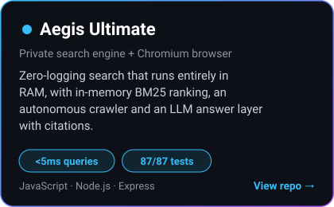
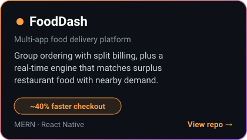
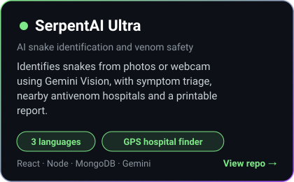
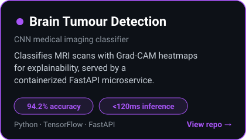
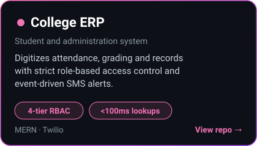
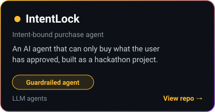

<!-- ============ HERO ============ -->

  

  

  
  
  

  
  
  
  

📧 <code>saeedzeeshan2003@gmail.com</code>

<!-- ============ ABOUT ============ -->
## 👨‍💻 About me

  

I'm a software engineer with strong fundamentals in data structures, algorithms and scalable backend design, plus hands-on full-stack experience. I've shipped 6+ production-grade and AI-integrated projects, from a sub-5ms search engine to a computer vision model and a multi-app delivery platform.

### 📈 Results at a glance

  

<!-- ============ TECH ============ -->
## 🛠️ Tech stack

  

<!-- ============ PROJECTS ============ -->
## 🚀 Featured projects

  

  

  

  

  

  

**Hackathon work:** [Standup Chief of Staff](https://github.com/zeeshansaeed6/Standup-Chief-of-Staff), an MCP project for the Alexa+ track of the Amazon Developer Hackathon.

<b>📂 More projects</b>

 

- 🛒 [E-CommWeb](https://github.com/zeeshansaeed6/E-CommWeb)
- 🏍️ [Pro Moto Hub](https://github.com/zeeshansaeed6/pro-moto-hub)
- ⚙️ [Conveyor Belt Manager](https://github.com/zeeshansaeed6/Conveyor-Belt-Manager)
- 🌐 [Portfolio source](https://github.com/zeeshansaeed6/Portfolio)

<!-- ============ LEETCODE ============ -->
## 🧩 Problem solving

  

<!-- ============ CERTS ============ -->
## 📜 Certifications

**☁️ Cloud & AI**
- AWS Certified Machine Learning
- AWS Cloud Practitioner Essentials
- Oracle Cloud Infrastructure AI Foundations Associate
- Snowflake Generative AI Professional
- Google Cloud AI
- Microsoft Azure AI Essentials

**💻 Software engineering & problem solving**
- HackerRank Software Engineer
- HackerRank Problem Solving (Intermediate)

**🏢 Job simulations**
- Advanced Software Engineering, Walmart USA (Forage)
- Software Engineering, BlackBird
- Technology, Deloitte Australia

<!-- ============ ACTIVITY ============ -->
## 📊 GitHub activity

  

  

  

  <picture>
    <source media="(prefers-color-scheme: dark)" srcset="https://raw.githubusercontent.com/zeeshansaeed6/zeeshansaeed6/output/github-snake-dark.svg">
    <source media="(prefers-color-scheme: light)" srcset="https://raw.githubusercontent.com/zeeshansaeed6/zeeshansaeed6/output/github-snake.svg">
    
  </picture>

<!-- ============ CONTACT ============ -->
## 🤝 Let's build something

  <i>Got an idea, an internship or a project? I'd love to hear about it.</i>  
  <a href="https://mail.google.com/mail/?view=cm&fs=1&to=saeedzeeshan2003@gmail.com&su=Hello%20Zeeshan">📧 Email</a>
  &nbsp;·&nbsp;
  <a href="https://linkedin.com/in/zeeshan-saeed0609">💼 LinkedIn</a>
  &nbsp;·&nbsp;
  <a href="https://www.zeeshansaeed.me">🌐 Portfolio</a>

  

