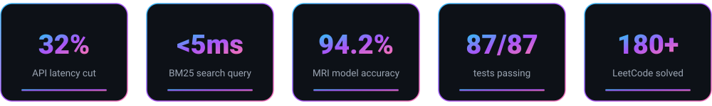

<!-- ============ HERO ============ -->

  

  

  
  
  
  

  
  
  
  

📧 <code>saeedzeeshan2003@gmail.com</code>

<!-- ============ ABOUT ============ -->
## 👨‍💻 About me

  

I'm a software engineer with strong fundamentals in data structures, algorithms and scalable backend design, plus hands-on full-stack experience. I've shipped 6+ production-grade and AI-integrated projects, from a sub-5ms search engine to a computer vision model and a multi-app delivery platform.

### 📈 Results at a glance

  

<!-- ============ TECH ============ -->
## 🛠️ Tech stack

  

  

<!-- ============ PROJECTS ============ -->
## 🚀 Featured projects

<table>
  <tr>
    <td width="50%"></td>
    <td width="50%"></td>
  </tr>
  <tr>
    <td width="50%"></td>
    <td width="50%"></td>
  </tr>
  <tr>
    <td width="50%"></td>
    <td width="50%"></td>
  </tr>
</table>

<b>✨ What each project does</b>

 

| Project | Highlights |
|---|---|
| 🛡️ **Aegis Ultimate** | Zero-logging private search engine and Chromium browser running in volatile RAM. In-memory **BM25 ranking in under 5ms**, autonomous crawler with offline inverted indexing, LLM answers with grounded citations, Web Time Machine. **87/87 tests** across 10 suites. |
| 🍔 **FoodDash** | Multi-app food delivery platform (MERN + React Native). **Group ordering with split billing** cut group checkout time by about 40%. **Real-time surplus-food matching** pairs spare restaurant inventory with nearby demand. |
| 🐍 **SerpentAI Ultra** | Gemini Vision snake identification from photos or webcam, venom risk ratings, symptom triage, nearest antivenom hospitals by GPS, chatbot, printable ER report, English / Hindi / Spanish. |
| 🧠 **Brain Tumour Detection** | TensorFlow CNN on 3,000+ MRI scans: **94.2% accuracy, 0.93 F1**. Grad-CAM heatmaps for explainability, FastAPI service in **under 120ms**. |
| 🎓 **College ERP** | MERN system with **4-tier RBAC** (Admin, Faculty, Student, Parent), **sub-100ms** lookups and event-driven Twilio SMS alerts. |
| 🔐 **IntentLock** | Intent-bound purchase agent that only buys what the user approved. |
| 🎙️ **Standup Chief of Staff** | MCP project for the Alexa+ track of the Amazon Developer Hackathon. |

<b>📂 More projects</b>

 

- 🛒 [E-CommWeb](https://github.com/zeeshansaeed6/E-CommWeb)
- 🏍️ [Pro Moto Hub](https://github.com/zeeshansaeed6/pro-moto-hub)
- ⚙️ [Conveyor Belt Manager](https://github.com/zeeshansaeed6/Conveyor-Belt-Manager)
- 🌐 [Portfolio source](https://github.com/zeeshansaeed6/Portfolio)

<!-- ============ LEETCODE ============ -->
## 🧩 Problem solving

  

<!-- ============ CERTS ============ -->
## 📜 Certifications

  
  
  
  

<!-- ============ ACTIVITY ============ -->
## 📊 GitHub activity

  
  

  

  

  <picture>
    <source media="(prefers-color-scheme: dark)" srcset="https://raw.githubusercontent.com/zeeshansaeed6/zeeshansaeed6/output/github-snake-dark.svg">
    <source media="(prefers-color-scheme: light)" srcset="https://raw.githubusercontent.com/zeeshansaeed6/zeeshansaeed6/output/github-snake.svg">
    
  </picture>

<!-- ============ QUOTE + CONTACT ============ -->

  

## 🤝 Let's build something

  <i>Got an idea, an internship or a project? I'd love to hear about it.</i>  
  <a href="https://mail.google.com/mail/?view=cm&fs=1&to=saeedzeeshan2003@gmail.com&su=Hello%20Zeeshan">📧 saeedzeeshan2003@gmail.com</a>
  &nbsp;·&nbsp;
  <a href="https://linkedin.com/in/zeeshan-saeed0609">💼 LinkedIn</a>
  &nbsp;·&nbsp;
  <a href="https://www.zeeshansaeed.me">🌐 Portfolio</a>

  

