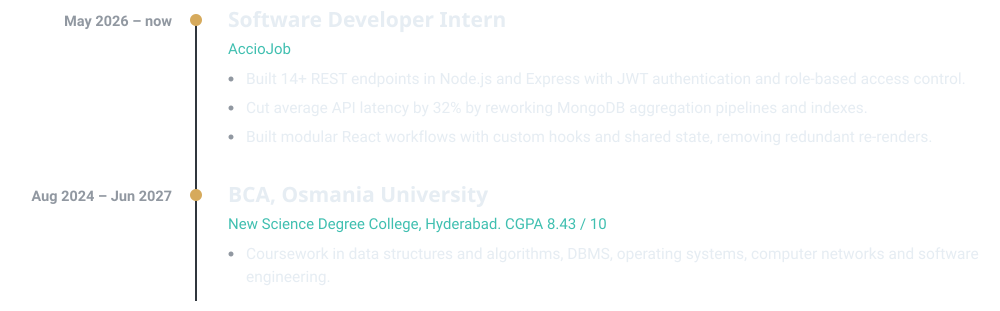
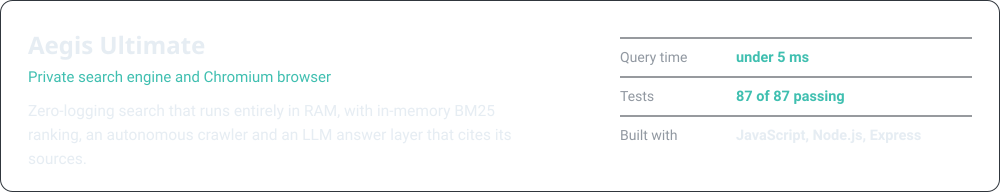
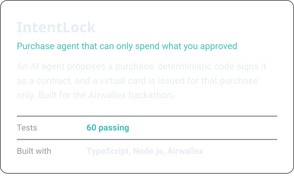
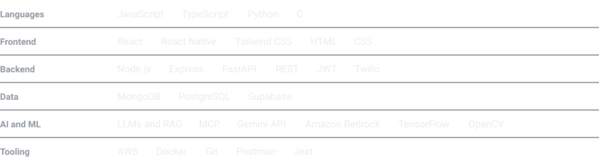
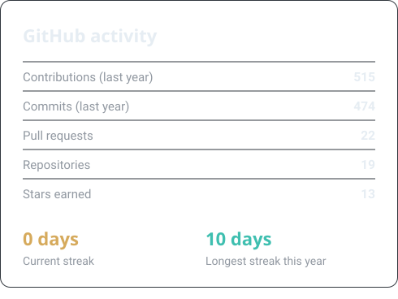
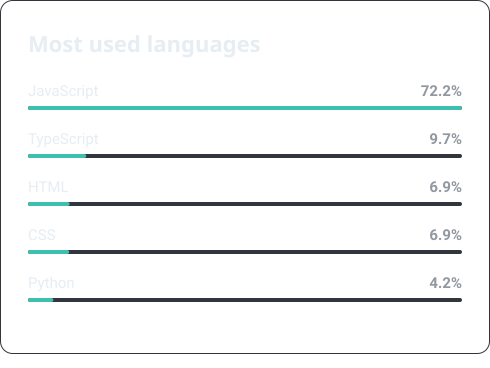

<!-- Images are generated. Static ones: node scripts/build-assets.mjs. Stats and snake: .github/workflows/snake.yml -->

<picture><source media="(prefers-color-scheme: light)" srcset="https://raw.githubusercontent.com/zeeshansaeed6/zeeshansaeed6/main/assets/light/hero.svg"></picture>

**[zeeshansaeed.me](https://www.zeeshansaeed.me)** &emsp; [LinkedIn](https://linkedin.com/in/zeeshan-saeed0609) &emsp; [LeetCode](https://leetcode.com/u/zeeshansaeed06/) &emsp; [Email me](https://mail.google.com/mail/?view=cm&fs=1&to=saeedzeeshan2003@gmail.com&su=Hello%20Zeeshan)

I build backends that stay fast under load and AI features that do real work. Recent projects include a private search engine that answers in under 5 ms, a voice assistant for developers built on MCP and Amazon Bedrock, and a purchasing agent that can only spend what a signed contract allows.

## Experience and education

<picture><source media="(prefers-color-scheme: light)" srcset="https://raw.githubusercontent.com/zeeshansaeed6/zeeshansaeed6/main/assets/light/experience.svg"></picture>

## Projects

  <a href="https://github.com/zeeshansaeed6/Aegis-Ultimate"><picture><source media="(prefers-color-scheme: light)" srcset="https://raw.githubusercontent.com/zeeshansaeed6/zeeshansaeed6/main/assets/light/project-aegis.svg"></picture></a>

  <a href="https://github.com/zeeshansaeed6/Standup-Chief-of-Staff"><picture><source media="(prefers-color-scheme: light)" srcset="https://raw.githubusercontent.com/zeeshansaeed6/zeeshansaeed6/main/assets/light/project-standup.svg"></picture></a>
  <a href="https://github.com/zeeshansaeed6/IntentLock"><picture><source media="(prefers-color-scheme: light)" srcset="https://raw.githubusercontent.com/zeeshansaeed6/zeeshansaeed6/main/assets/light/project-intentlock.svg"></picture></a>

  <a href="https://github.com/zeeshansaeed6/FoodDash"><picture><source media="(prefers-color-scheme: light)" srcset="https://raw.githubusercontent.com/zeeshansaeed6/zeeshansaeed6/main/assets/light/project-fooddash.svg"></picture></a>
  <a href="https://github.com/zeeshansaeed6/SerpentAI-"><picture><source media="(prefers-color-scheme: light)" srcset="https://raw.githubusercontent.com/zeeshansaeed6/zeeshansaeed6/main/assets/light/project-serpentai.svg"></picture></a>

  <a href="https://github.com/zeeshansaeed6/BrainTumorDetection"><picture><source media="(prefers-color-scheme: light)" srcset="https://raw.githubusercontent.com/zeeshansaeed6/zeeshansaeed6/main/assets/light/project-braintumour.svg"></picture></a>
  <a href="https://github.com/zeeshansaeed6/CollegeERP"><picture><source media="(prefers-color-scheme: light)" srcset="https://raw.githubusercontent.com/zeeshansaeed6/zeeshansaeed6/main/assets/light/project-erp.svg"></picture></a>

Smaller projects

- [E-CommWeb](https://github.com/zeeshansaeed6/E-CommWeb)
- [Pro Moto Hub](https://github.com/zeeshansaeed6/pro-moto-hub)
- [Conveyor Belt Manager](https://github.com/zeeshansaeed6/Conveyor-Belt-Manager)
- [Source for my portfolio site](https://github.com/zeeshansaeed6/Portfolio)

## Stack

<picture><source media="(prefers-color-scheme: light)" srcset="https://raw.githubusercontent.com/zeeshansaeed6/zeeshansaeed6/main/assets/light/stack.svg"></picture>

## Problem solving

<a href="https://leetcode.com/u/zeeshansaeed06/"><picture><source media="(prefers-color-scheme: light)" srcset="https://leetcard.jacoblin.cool/zeeshansaeed06?theme=light&font=IBM%20Plex%20Sans&ext=heatmap&border=0&radius=12"></picture></a>

## Certifications

<!-- Link a certification to make it verifiable: - [AWS Certified Machine Learning](https://www.credly.com/badges/...) -->

**Cloud and AI:** AWS Certified Machine Learning, AWS Cloud Practitioner Essentials, Oracle Cloud Infrastructure AI Foundations Associate, Snowflake Generative AI Professional, Google Cloud AI, Microsoft Azure AI Essentials.

**Software engineering:** HackerRank Software Engineer, HackerRank Problem Solving (Intermediate).

**Job simulations:** Advanced Software Engineering at Walmart USA (Forage), Software Engineering at BlackBird, Technology at Deloitte Australia.

## On GitHub

  <picture><source media="(prefers-color-scheme: light)" srcset="https://raw.githubusercontent.com/zeeshansaeed6/zeeshansaeed6/output/stats-light.svg"></picture>
  <picture><source media="(prefers-color-scheme: light)" srcset="https://raw.githubusercontent.com/zeeshansaeed6/zeeshansaeed6/output/languages-light.svg"></picture>

<picture>
  <source media="(prefers-color-scheme: light)" srcset="https://raw.githubusercontent.com/zeeshansaeed6/zeeshansaeed6/output/github-snake.svg">
  
</picture>

---

Working on something where these skills fit? [Email me](https://mail.google.com/mail/?view=cm&fs=1&to=saeedzeeshan2003@gmail.com&su=Hello%20Zeeshan) or reach out on [LinkedIn](https://linkedin.com/in/zeeshan-saeed0609).
