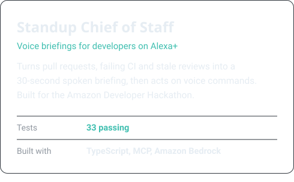
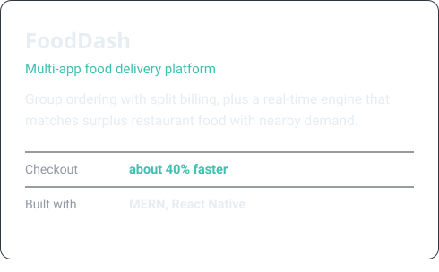
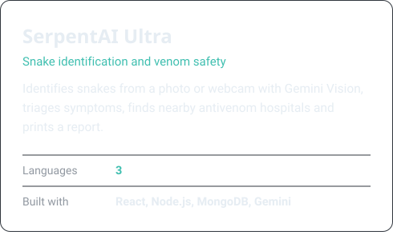
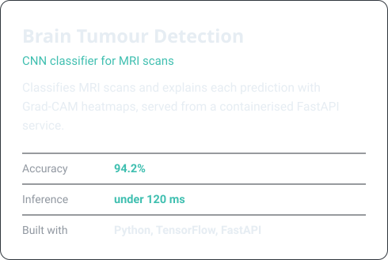
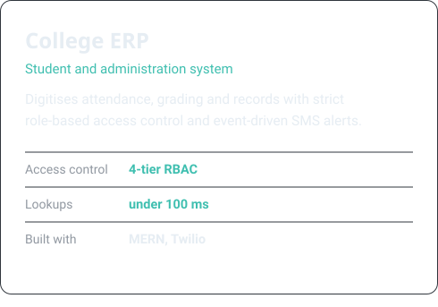
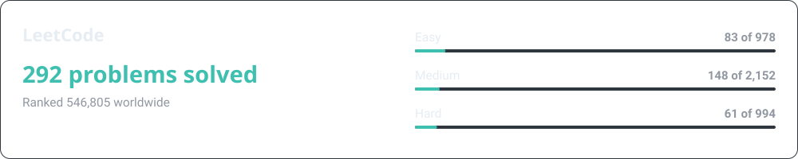

<!-- Images are generated. Static ones: node scripts/build-assets.mjs. Stats and snake: .github/workflows/snake.yml -->

<picture><source media="(max-width: 600px) and (prefers-color-scheme: light)" srcset="https://raw.githubusercontent.com/zeeshansaeed6/zeeshansaeed6/main/assets/light/hero-narrow.svg?v=2ddb8705"><source media="(max-width: 600px)" srcset="https://raw.githubusercontent.com/zeeshansaeed6/zeeshansaeed6/main/assets/dark/hero-narrow.svg?v=4bf29a49"><source media="(prefers-color-scheme: light)" srcset="https://raw.githubusercontent.com/zeeshansaeed6/zeeshansaeed6/main/assets/light/hero.svg?v=4b29b4d7"></picture>

**[zeeshansaeed.me](https://www.zeeshansaeed.me)** &emsp; [LinkedIn](https://linkedin.com/in/zeeshan-saeed0609) &emsp; [LeetCode](https://leetcode.com/u/zeeshansaeed06/) &emsp; [Email me](https://mail.google.com/mail/?view=cm&fs=1&to=saeedzeeshan2003@gmail.com&su=Hello%20Zeeshan)

I build backends that stay fast under load and AI features that do real work. Recent projects include a private search engine that answers in under 5 ms, a voice assistant for developers built on MCP and Amazon Bedrock, and a purchasing agent that can only spend what a signed contract allows.

## Experience and education

<picture><source media="(max-width: 600px) and (prefers-color-scheme: light)" srcset="https://raw.githubusercontent.com/zeeshansaeed6/zeeshansaeed6/main/assets/light/experience-narrow.svg?v=4cbe3204"><source media="(max-width: 600px)" srcset="https://raw.githubusercontent.com/zeeshansaeed6/zeeshansaeed6/main/assets/dark/experience-narrow.svg?v=b6ff995b"><source media="(prefers-color-scheme: light)" srcset="https://raw.githubusercontent.com/zeeshansaeed6/zeeshansaeed6/main/assets/light/experience.svg?v=7d9930e1"></picture>

## Projects

  <a href="https://github.com/zeeshansaeed6/Aegis-Ultimate"><picture><source media="(max-width: 600px) and (prefers-color-scheme: light)" srcset="https://raw.githubusercontent.com/zeeshansaeed6/zeeshansaeed6/main/assets/light/project-aegis-narrow.svg?v=be7d71cb"><source media="(max-width: 600px)" srcset="https://raw.githubusercontent.com/zeeshansaeed6/zeeshansaeed6/main/assets/dark/project-aegis-narrow.svg?v=e68727c7"><source media="(prefers-color-scheme: light)" srcset="https://raw.githubusercontent.com/zeeshansaeed6/zeeshansaeed6/main/assets/light/project-aegis.svg?v=6c48d018"></picture></a>

  <a href="https://github.com/zeeshansaeed6/Standup-Chief-of-Staff"><picture><source media="(prefers-color-scheme: light)" srcset="https://raw.githubusercontent.com/zeeshansaeed6/zeeshansaeed6/main/assets/light/project-standup.svg?v=1b912562"></picture></a>
  <a href="https://github.com/zeeshansaeed6/IntentLock"><picture><source media="(prefers-color-scheme: light)" srcset="https://raw.githubusercontent.com/zeeshansaeed6/zeeshansaeed6/main/assets/light/project-intentlock.svg?v=6c7591b9"></picture></a>

  <a href="https://github.com/zeeshansaeed6/FoodDash"><picture><source media="(prefers-color-scheme: light)" srcset="https://raw.githubusercontent.com/zeeshansaeed6/zeeshansaeed6/main/assets/light/project-fooddash.svg?v=d29ea77c"></picture></a>
  <a href="https://github.com/zeeshansaeed6/SerpentAI-"><picture><source media="(prefers-color-scheme: light)" srcset="https://raw.githubusercontent.com/zeeshansaeed6/zeeshansaeed6/main/assets/light/project-serpentai.svg?v=bde1427c"></picture></a>

  <a href="https://github.com/zeeshansaeed6/BrainTumorDetection"><picture><source media="(prefers-color-scheme: light)" srcset="https://raw.githubusercontent.com/zeeshansaeed6/zeeshansaeed6/main/assets/light/project-braintumour.svg?v=30a19c09"></picture></a>
  <a href="https://github.com/zeeshansaeed6/CollegeERP"><picture><source media="(prefers-color-scheme: light)" srcset="https://raw.githubusercontent.com/zeeshansaeed6/zeeshansaeed6/main/assets/light/project-erp.svg?v=150a746d"></picture></a>

More projects

- [OmniMarket](https://github.com/zeeshansaeed6/E-CommWeb): multi-vendor marketplace on MERN with Stripe escrow payments, split fulfilment per vendor and multi-currency pricing.
- [Pro Moto Hub](https://github.com/zeeshansaeed6/pro-moto-hub): website for a two-wheeler service business in Hyderabad, with services, a gallery, reviews and visit booking.
- [Conveyor Belt Manager](https://github.com/zeeshansaeed6/Conveyor-Belt-Manager): SCADA-style dashboard for monitoring and controlling conveyor belts, built to work on phones.
- [Portfolio](https://github.com/zeeshansaeed6/Portfolio): source for [zeeshansaeed.me](https://www.zeeshansaeed.me), built with React, Three.js and GSAP.

## Stack

<picture><source media="(max-width: 600px) and (prefers-color-scheme: light)" srcset="https://raw.githubusercontent.com/zeeshansaeed6/zeeshansaeed6/main/assets/light/stack-narrow.svg?v=f14d2f55"><source media="(max-width: 600px)" srcset="https://raw.githubusercontent.com/zeeshansaeed6/zeeshansaeed6/main/assets/dark/stack-narrow.svg?v=084f2585"><source media="(prefers-color-scheme: light)" srcset="https://raw.githubusercontent.com/zeeshansaeed6/zeeshansaeed6/main/assets/light/stack.svg?v=a23878d1"></picture>

## Problem solving

<a href="https://leetcode.com/u/zeeshansaeed06/"><picture><source media="(max-width: 600px) and (prefers-color-scheme: light)" srcset="https://raw.githubusercontent.com/zeeshansaeed6/zeeshansaeed6/output/leetcode-narrow-light.svg"><source media="(max-width: 600px)" srcset="https://raw.githubusercontent.com/zeeshansaeed6/zeeshansaeed6/output/leetcode-narrow.svg"><source media="(prefers-color-scheme: light)" srcset="https://raw.githubusercontent.com/zeeshansaeed6/zeeshansaeed6/output/leetcode-light.svg"></picture></a>

## Certifications

<!-- Link a certification to make it verifiable: - [AWS Certified Machine Learning](https://www.credly.com/badges/...) -->

**Cloud and AI**
- AWS Certified Machine Learning
- AWS Cloud Practitioner Essentials
- Oracle Cloud Infrastructure AI Foundations Associate
- Snowflake Generative AI Professional
- Google Cloud AI
- Microsoft Azure AI Essentials

**Software engineering**
- HackerRank Software Engineer
- HackerRank Problem Solving (Intermediate)

**Job simulations**
- Advanced Software Engineering, Walmart USA (Forage)
- Software Engineering, BlackBird
- Technology, Deloitte Australia

## On GitHub

  <picture><source media="(prefers-color-scheme: light)" srcset="https://raw.githubusercontent.com/zeeshansaeed6/zeeshansaeed6/output/stats-light.svg"></picture>
  <picture><source media="(prefers-color-scheme: light)" srcset="https://raw.githubusercontent.com/zeeshansaeed6/zeeshansaeed6/output/languages-light.svg"></picture>

<picture>
  <source media="(prefers-color-scheme: light)" srcset="https://raw.githubusercontent.com/zeeshansaeed6/zeeshansaeed6/output/github-snake.svg">
  
</picture>

---

Working on something where these skills fit? [Email me](https://mail.google.com/mail/?view=cm&fs=1&to=saeedzeeshan2003@gmail.com&su=Hello%20Zeeshan) or reach out on [LinkedIn](https://linkedin.com/in/zeeshan-saeed0609).
